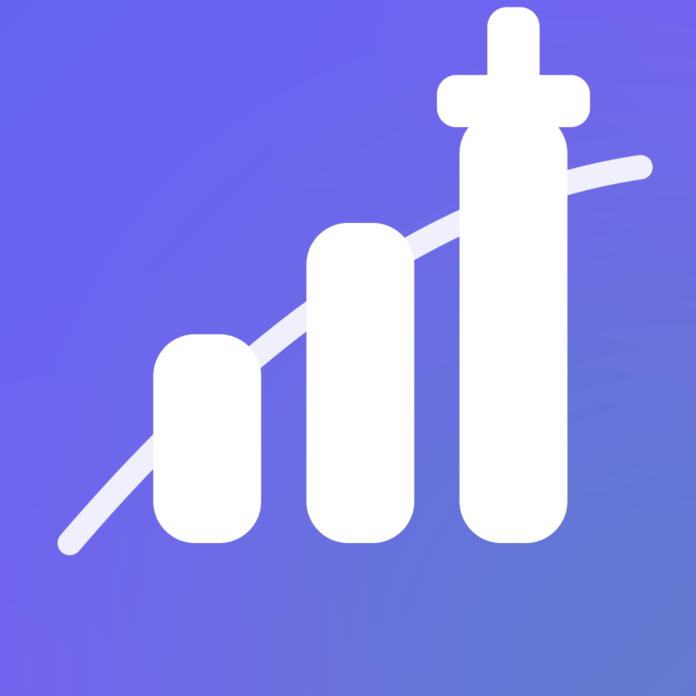

<div align="center">
  

# 🚀 Emprende+

**Gestión inteligente para emprendimientos creativos**

  <p align="center">
    <a href="#-características"><strong>Características</strong></a> ·
    <a href="#-stack-tecnológico"><strong>Stack</strong></a> ·
    <a href="#-arquitectura"><strong>Arquitectura</strong></a> ·
    <a href="#-modelos-de-datos"><strong>Modelos</strong></a> ·
    <a href="#-roadmap"><strong>Roadmap</strong></a> ·
    <a href="#-quick-start"><strong>Quick Start</strong></a>
  </p>

  <p>
    
    
    
    
    
    
    
    
    
  </p>
</div>

---

## ✨ Características

<table>
  <tr>
    <td align="center" width="50%">
      <h3>📊 Dashboard</h3>
      <p>Resumen financiero con gráficos de ingresos vs egresos, distribución por categorías, últimas ventas y stock bajo.</p>
      <sub>Selecciona USD o VES, filtra por período (hoy / semana / mes / todo)</sub>
    </td>
    <td align="center" width="50%">
      <h3>🧮 Cotizador Multimoneda</h3>
      <p>Selecciona servicios, arma un carrito, ve los totales en <strong>USD</strong> y <strong>Bs.</strong> en tiempo real con la tasa BCV.</p>
      <sub>Exporta como imagen PNG o PDF, comparte al instante</sub>
    </td>
  </tr>
  <tr>
    <td align="center" width="50%">
      <h3>📋 Gestión de Servicios</h3>
      <p>CRUD completo de servicios con precio USD, categoría, y cálculo automático del precio en bolívares.</p>
      <sub>Búsqueda, filtro por categoría, activación/desactivación</sub>
    </td>
    <td align="center" width="50%">
      <h3>💰 Ventas</h3>
      <p>Registra ventas desde cotizaciones, con 7 métodos de pago. Historial completo con filtros y búsqueda.</p>
      <sub>Exporta a CSV, filtra por método de pago y cliente frecuente</sub>
    </td>
  </tr>
  <tr>
    <td align="center" width="50%">
      <h3>📦 Inventario de Materiales</h3>
      <p>Controla materiales con precio de compra en USD/Bs., categorías, unidades, proveedores y alertas de stock bajo.</p>
      <sub>Umbral configurable por item, foto del material</sub>
    </td>
    <td align="center" width="50%">
      <h3>💸 Egresos y Compras</h3>
      <p>Registra gastos operativos, compras e insumos con categorías, método de pago y proveedor.</p>
      <sub>Filtro por categoría, exportación CSV, búsqueda</sub>
    </td>
  </tr>
  <tr>
    <td align="center" width="50%">
      <h3>👥 Gestión de Clientes</h3>
      <p>Los clientes se guardan automáticamente al registrar una venta. Con historial de compras y total gastado.</p>
      <sub>Contacto, ventas por cliente, edición</sub>
    </td>
    <td align="center" width="50%">
      <h3>🌙 Modo Oscuro</h3>
      <p>Tema claro/oscuro completo en toda la app. Persistente entre sesiones. Respeta la configuración del sistema.</p>
      <sub>Toggle desde la pantalla de Ajustes y el header</sub>
    </td>
  </tr>
  <tr>
    <td align="center" width="50%">
      <h3>💾 Backup & Restauración</h3>
      <p>Exporta todos tus datos como archivo JSON y restáuralos cuando quieras. Ideal para migrar entre dispositivos.</p>
      <sub>Exportar / Importar con confirmación de seguridad</sub>
    </td>
    <td align="center" width="50%">
      <h3>📈 Historial de Tasas</h3>
      <p>Todas las tasas BCV usadas en ventas, cotizaciones y egresos, con fecha y fuente (BCV / Manual / Caché).</p>
      <sub>Cache automático de 6 horas, entrada manual como fallback</sub>
    </td>
  </tr>
  <tr>
    <td align="center" width="50%">
      <h3>📄 Exportación PDF</h3>
      <p>Exporta cotizaciones a PDF con diseño profesional: logo, datos del cliente, tabla de servicios, totales y tasa del día.</p>
      <sub>Compatible con expo-print + expo-sharing</sub>
    </td>
    <td align="center" width="50%">
      <h3>♿ Accesibilidad</h3>
      <p>Roles y etiquetas de accesibilidad en todos los componentes. Anuncios de voz para Toast y estados de carga.</p>
      <sub>Compatibilidad total con lectores de pantalla</sub>
    </td>
  </tr>
</table>

---

## 🛠 Stack Tecnológico

| Capa                         | Tecnología            | Versión                   |
| ---------------------------- | --------------------- | ------------------------- |
| 📱 Framework                 | React Native + Expo   | SDK 54 / RN 0.81          |
| 🔤 Lenguaje                  | TypeScript            | 5.9 (strict)              |
| 🧭 Routing                   | Expo Router           | v6 (file-based)           |
| 🎨 Estilos                   | NativeWind            | v4 (Tailwind CSS para RN) |
| ⚡ Estado global             | Zustand               | v5                        |
| 🗄️ Persistencia estructurada | SQLite                | expo-sqlite 16            |
| 🏎️ Persistencia rápida       | MMKV                  | react-native-mmkv         |
| 📝 Formularios               | React Hook Form + Zod | latest                    |
| 📅 Fechas                    | date-fns              | v4                        |
| 🧪 Testing                   | Jest + RNTL           | 37 tests                  |
| 📦 Package Manager           | pnpm                  | latest                    |
| 🎨 Iconos                    | @expo/vector-icons    | Ionicons                  |

---

## 📐 Arquitectura

```
┌─────────────────────────────────────────────────┐
│                  Screen (app/)                  │
│          (Expo Router — file-based)             │
├─────────────────────────────────────────────────┤
│              Component (components/)            │
│       ui/ (átomos) · forms/ · shared/           │
├─────────────────────────────────────────────────┤
│          Hook (features/)                       │
│  Lógica de negocio compuesta store + API + DB   │
├─────────────────────────────────────────────────┤
│     Store (store/) · API (services/api/)        │
│  Zustand puro (síncrono) · BCV REST API         │
├─────────────────────────────────────────────────┤
│      Repositorio (services/db/repositories/)    │
│          SQLite · expo-sqlite síncrono           │
└─────────────────────────────────────────────────┘
```

### Persistencia: MMKV vs SQLite

| 📦 MMKV (clave-valor, ultra-rápido) | 🗄️ SQLite (estructurado, queries) |
| ----------------------------------- | --------------------------------- |
| Tasa de cambio cacheada (BCV)       | Servicios                         |
| Preferencias del usuario            | Cotizaciones y Items              |
| Última fecha de sync                | Ventas                            |
| Configuración de la app             | Items de inventario               |
| Tema (claro/oscuro)                 | Egresos                           |
|                                     | Clientes                          |

---

## 🧩 Modelos de Datos

<details>
<summary><strong>Service</strong> — Servicios ofrecidos</summary>

```typescript
interface Service {
  id: string; // crypto.randomUUID()
  name: string;
  description?: string;
  priceUSD: number; // > 0
  priceVES: number; // calculado con tasa BCV
  isActive: boolean;
  createdAt: string; // ISO 8601
  updatedAt: string;
}
```

</details>

<details>
<summary><strong>Quote</strong> — Cotizaciones</summary>

```typescript
interface Quote {
  id: string;
  items: QuoteItem[];
  totalUSD: number;
  totalVES: number;
  exchangeRate: number;
  exchangeRateDate: string;
  clientName?: string;
  notes?: string;
  status: 'draft' | 'sent' | 'accepted' | 'rejected';
  imageUri?: string;
  createdAt: string;
}
```

</details>

<details>
<summary><strong>Sale</strong> — Ventas</summary>

```typescript
interface Sale {
  id: string;
  quoteId?: string;
  items: QuoteItem[];
  totalUSD: number;
  totalVES: number;
  exchangeRate: number;
  clientName?: string;
  paymentMethod: PaymentMethod;
  // 'usd_cash' | 'ves_cash' | 'pago_movil'
  // | 'kontigo' | 'binance' | 'transfer_ves' | 'other'
  notes?: string;
  createdAt: string;
}
```

</details>

<details>
<summary><strong>InventoryItem</strong> — Inventario</summary>

```typescript
interface InventoryItem {
  id: string;
  name: string;
  description?: string;
  category: string;
  quantity: number;
  unit: string; // 'unidad' | 'kg' | 'litro' | 'metro' ...
  purchasePriceUSD: number;
  purchasePriceVES: number;
  exchangeRateAtPurchase: number;
  supplier?: string;
  purchaseDate: string;
  notes?: string;
  photoUri?: string;
  lowStockThreshold?: number;
  createdAt: string;
}
```

</details>

<details>
<summary><strong>Expense</strong> — Egresos</summary>

```typescript
interface Expense {
  id: string;
  description: string;
  category: string;
  amountUSD: number;
  amountVES: number;
  exchangeRate: number;
  paymentMethod: PaymentMethod;
  supplier?: string;
  notes?: string;
  createdAt: string;
}
```

</details>

---

## 🎨 Design System

| Token        | Light               | Dark      | Uso                           |
| ------------ | ------------------- | --------- | ----------------------------- |
| `primary`    | `#6366F1` (Indigo)  | `#818CF8` | Acciones principales, botones |
| `secondary`  | `#10B981` (Emerald) | `#34D399` | Éxito, confirmación           |
| `background` | `#F9FAFB`           | `#111827` | Fondo general                 |
| `surface`    | `#FFFFFF`           | `#1F2937` | Tarjetas, modales             |
| `text`       | `#111827`           | `#F9FAFB` | Texto principal               |
| `error`      | `#EF4444`           | `#F87171` | Errores, alerts               |
| `border`     | `#E5E7EB`           | `#374151` | Bordes de inputs/cards        |

**Tipografía:** System Font (SF Pro iOS / Roboto Android) · Escala: 12 / 14 / 16 / 18 / 20 / 24 / 30  
**Spacing:** Escala 4-8-12-16-24-32-48-64

---

## 🚀 Quick Start

```bash
# 1. Instalar dependencias
pnpm install

# 2. Iniciar la app
pnpm start

# 3. Abrir en dispositivo/emulador
pnpm android    # Android
pnpm ios        # iOS (requiere macOS + Xcode)
pnpm web        # Navegador

# 4. Linter y formato
pnpm lint       # ESLint
pnpm format     # Prettier

# 5. TypeScript
pnpm typecheck  # tsc --noEmit

# 6. Tests
pnpm test       # Jest — 37 tests
```

---

## 📁 Estructura del Proyecto

```
emprende-plus/
├── app/                          # Expo Router (file-based routing)
│   ├── _layout.tsx               # Root layout (providers)
│   ├── (tabs)/
│   │   ├── _layout.tsx           # Bottom tab navigator
│   │   ├── index.tsx             # Dashboard / Resumen
│   │   ├── calculator.tsx        # Cotizador
│   │   ├── sales.tsx             # Historial de ventas
│   │   ├── inventory.tsx         # Inventario
│   │   ├── expenses.tsx          # Egresos
│   │   ├── clients.tsx           # Clientes
│   │   └── settings.tsx          # Ajustes
│   ├── services/                 # Detalle/edición de servicios
│   ├── quotes/                   # Detalle de cotización
│   ├── sales/                    # Detalle de venta
│   ├── inventory/                # Detalle de material
│   ├── expenses/                 # Detalle/creación de egreso
│   └── clients/                  # Detalle de cliente
├── src/
│   ├── components/
│   │   ├── ui/                   # Button, Input, Card, Badge, Modal, Toast, ThemeToggle
│   │   ├── forms/                # ServiceForm, ExpenseForm, QuoteForm, SaleForm, InventoryForm
│   │   └── shared/               # DashboardCard, CartItem, QuoteImage, RateIndicator, etc.
│   ├── features/                 # Hooks de negocio compuestos
│   ├── hooks/                    # useExchangeRate, useExportQuote, useThemeColors
│   ├── services/
│   │   ├── api/                  # BCV API service
│   │   ├── pdf/                  # Generación de PDF
│   │   └── db/                   # SQLite schema, migrations, repositories
│   ├── store/                    # Zustand stores (service, quote, sale, inventory, expense, rate, theme, toast)
│   ├── types/                    # TypeScript interfaces
│   ├── constants/                # colors, strings, layout, theme
│   ├── lib/                      # db.ts, storage.ts
│   └── utils/                    # csv.ts, id.ts
├── __tests__/                    # 37 tests (stores, repositories, utils, logo)
├── __mocks__/                    # Mocks para expo-crypto, expo-sqlite, expo-sharing, expo-file-system
└── specs/                        # Specs F01–F15 (Spec-Driven Development)
```

---

## 🧪 Testing

```
Test Suites: 4 passed, 4 total
Tests:       37 passed, 37 total
Snapshots:   0 total
Time:        5.825 s
```

- **Stores** (Zustand): ServiceStore, SaleStore, InventoryStore, ExpenseStore, RateStore, ToastStore
- **Repositories** (SQLite): CRUD de todas las entidades
- **Utils**: formato de moneda, fechas, IDs
- **Componentes**: Logo de la marca (brand)

---

## 🔌 APIs Externas

| Servicio                                           | Endpoint                            | Uso                              |
| -------------------------------------------------- | ----------------------------------- | -------------------------------- |
| [bcv-api.rafnixg.dev](https://bcv-api.rafnixg.dev) | `GET /v1/exchange-rates/latest/USD` | Tasa BCV oficial                 |
| [cotizave.com](https://cotizave.com)               | `GET /api/v1/rates`                 | Fallback (BCV + paralelo + USDT) |

**Estrategia de caché:** 6 horas en MMKV · Fallback automático · Entrada manual disponible

---

## 📄 Licencia

```
MIT License
Copyright (c) 2026 Emprende+
```

---

<div align="center">
  <sub>Hecho con ❤️ para emprendedores venezolanos · 🇻🇪</sub>
  <br />
  <sub>by Jorge Niño</sub>
</div>
